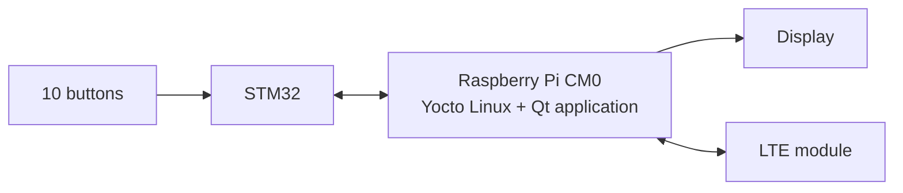

# Reflex Wall: A Custom Yocto-Based Embedded Linux Kiosk Platform

**COME 361 Operating Systems – Term Project**

Reflex Wall is an interactive kiosk device with 10 illuminated buttons and a display. The game is only the reference application. The project itself is the embedded Linux system underneath: a custom Linux distribution built from source with the Yocto Project, running on a custom board based on the Raspberry Pi CM0.

The device boots straight into a single application with a seamless splash screen, handles time-critical button input on an STM32 microcontroller, and reports its status over LTE.

## Team

| Student No. | Name | Role |
| --- | --- | --- |
| 202303001137 | Şevket Eren Kaynar | Platform: Yocto image, boot chain and splash screen, custom PCB |
| 202203001038 | Didem Akalan | Application layer: Qt user interface and telemetry |
| 202303001132 | Mert Azat Söğüt | I/O layer: STM32 firmware and I/O daemon |

## Repositories

| Repository | Purpose |
| --- | --- |
| [yocto-embedded-kiosk-project-come361](https://github.com/sqayner/yocto-embedded-kiosk-project-come361) | Overall project description and architecture (this repository) |
| [ReflexWall-System](https://github.com/didemakalan/ReflexWall-System) | Qt Quick application: the game and the user interface shown on the device |
| [ReflexWall-stm32](https://github.com/mertazat/ReflexWall-stm32) | STM32 firmware: reads the buttons, measures reaction time and controls the LEDs |
| [meta-reflexwall](https://github.com/sqayner/meta-reflexwall) | Custom Yocto layer: builds the Linux image with the splash screen, the application and its system services |
| [cm0-reflexwall-baseboard](https://github.com/sqayner/cm0-reflexwall-baseboard) | Custom PCB design that brings the CM0, the STM32 and the LTE module together on one board |

## Architecture

The STM32 handles the buttons and measures reaction time with its own hardware timer, because a general-purpose Linux system cannot guarantee how quickly it responds to an input. Linux runs the user interface and the system services, and sends status information over LTE.

## Operating System Concepts

| Concept | Where it appears in the project |
| --- | --- |
| Process management | systemd starts, supervises and restarts the services |
| Concurrency | The hardware service serves several programs at the same time |
| Processor scheduling | Input latency on a standard kernel vs. a real-time kernel |
| File systems | Read-only root filesystem that survives power loss |
| Inter-process communication | Socket communication between the hardware service and the UI |
| I/O and device drivers | Buttons, display and LTE modem on custom hardware |
